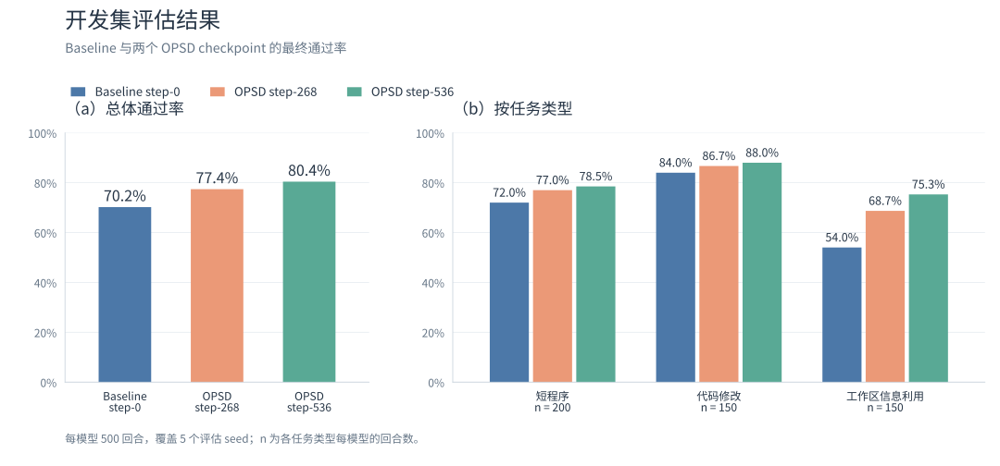

<h1 align="center">bashlet</h1>

<p align="center">
  
</p>

<p align="center">
  <strong>A Tiny Coding Agent with On-Policy Self-Distillation.</strong>
</p>

<p align="center">
  <a href="pyproject.toml"></a>
  <a href="configs/defaults.yaml"></a>
  <a href="#training"></a>
  <a href="environments/local-vllm/"></a>
</p>

<p align="center">
  <a href="#results">📊 实验结果</a> ·
  <a href="#features">✨ 核心能力</a> ·
  <a href="#quickstart">🚀 快速开始</a> ·
  <a href="#models">🔌 接入真实模型</a> ·
  <a href="#training">🧬 训练与评测入口</a> ·
  <a href="#development">🛠️ 开发检查</a>
</p>

---

bashlet 是一个通过 bash 命令编写、运行和修复代码的极简编程智能体。

项目研究 Harness + On-Policy Self-Distillation（OPSD）：学生模型和教师模型都从 [Qwen3.5-4B](https://huggingface.co/Qwen/Qwen3.5-4B) 初始化得到；学生执行编程任务生成真实交互轨迹，教师模型保持冻结，并结合参考实现为学生生成的轨迹提供 token-level 的监督。

<a id="results"></a>

## 📊 实验结果

在相同的 500 个开发集评估回合上，对比 Baseline 和两个 OPSD checkpoint。每个模型覆盖 5 个评估 seed，每个 seed 100 回合。



| 评估对象 | 通过回合数 | 最终通过率 | 平均生成 tokens | 平均交互步数 |
| --- | ---: | ---: | ---: | ---: |
| Baseline step-0 | 351 / 500 | 70.2% | 1708.908 | 8.424 |
| OPSD step-268 | 387 / 500 | 77.4% | 1979.854 | 9.152 |
| OPSD step-536 | 402 / 500 | 80.4% | 1796.788 | 8.564 |

> 生成 tokens 包含 thinking。两项开销均为全部 500 回合的每回合均值。

<a id="features"></a>

## ✨ 核心能力

- 💻 **任务交互**：`agent` 接收自然语言指令和工作目录；`task` 运行带独立评分的编程任务。
- 🛡️ **隔离执行**：使用 [Bubblewrap](https://github.com/containers/bubblewrap) 沙箱，每步启动新 shell，工作区文件在步骤之间保留。
- 📝 **轨迹记录**：保存命令、真实观察、工作区变化，以及采样生成的原始 token 和 logprob。
- 🧠 **后训练与评测**：通过 [PyTRIO](https://pytrio.com) 进行 OPSD 训练；同时支持本地 vLLM 采样与评测。

<a id="quickstart"></a>

## 🚀 快速开始

### 🧰 环境要求

- **宿主环境**：Python 3.13+ 和 uv。
- **执行环境**：Linux，允许创建 user、mount、PID、network namespaces；提供 `/usr/bin/bwrap`、`/usr/bin/prlimit`、`/bin/bash`，以及 git、awk、sed、grep。
- **默认沙箱环境**：`/usr/bin/python3` 为 Python 3.10.12，独立虚拟环境使用锁定的 pytest 9.1.1。其他环境需调整[默认配置](configs/defaults.yaml)中的 `environment` 设置。

### 🧪 运行示例任务

在仓库根目录执行：

```bash
uv sync --locked
uv sync --project environments/sandbox-python --python /usr/bin/python3 --locked
uv run --locked bashlet task examples/sum.json
```

此示例使用 `ReplayModel` 的预写回复，在真实沙箱中运行代码、执行反馈测试并提交评分，无需 GPU 或 API Key。结束后会显示评分，产物保存在 `runs/<运行 ID>/`。

查看运行记录时，将 `runs/RUN_ID` 替换为 CLI 输出的运行目录：

```bash
uv run --locked bashlet show runs/RUN_ID
```

更多任务示例见 [examples/](examples/)。

### 🤖 直接运行 agent

对工作目录下达指令。以下示例仍使用预写回复：

```bash
mkdir -p runs/demo-input
uv run --locked bashlet agent "创建 result.txt，然后提交" \
  --workdir runs/demo-input \
  --set 'model.replies=["```bash\ntouch result.txt\necho COMPLETE_TASK_AND_SUBMIT_FINAL_OUTPUT\n```"]'
```

`agent` 操作输入目录的副本，结果保存在本次运行的 `workspace/` 中。通过 `-c` 选择模型配置；多个配置按顺序覆盖，`--set key=value` 覆盖单项设置。

<a id="models"></a>

## 🔌 接入真实模型

将 `PYTRIO_API_KEY=你的密钥` 写入仓库根目录的 `.env`。训练参数在 [configs/opsd.yaml](configs/opsd.yaml) 中设置。

本地 vLLM 的依赖位于 [environments/local-vllm/](environments/local-vllm/)。准备模型权重后，调整 `opsd.yaml` 的 `evaluation.base_path`、服务地址和 `evaluation.server.options`，再启动服务：

```bash
uv sync --project environments/local-vllm --python 3.12 --locked
bash scripts/serve-local-vllm.sh
```

<a id="training"></a>

## 🧬 训练与评测入口

OPSD 从原始指令模型开始，学生更新，教师模型冻结。训练使用 PyTRIO，评测兼容使用本地 vLLM。

agent 和沙箱设置见 [configs/defaults.yaml](configs/defaults.yaml)；训练和评测参数在 [configs/opsd.yaml](configs/opsd.yaml) 中修改。

```bash
uv run --locked bashlet train-opsd configs/opsd.yaml
uv run --locked bashlet train-opsd configs/opsd.yaml --resume
uv run --locked bashlet evaluate-checkpoint configs/opsd.yaml --phase final
uv run --locked bashlet watch-opsd --config configs/opsd.yaml
```

训练中断后，添加 `--resume` 继续运行。继续同一次训练时保持原配置。训练完成后，可用 `--phase test` 评测最终测试集。

| 用途 | CLI 命令 | 配置或说明 |
| --- | --- | --- |
| 准备 MBPP 任务 | `prepare-mbpp --source-lock data/sources.json` | [来源定义](data/sources.json) |
| 导入公开任务 | `import-public-tasks data/sources.json --catalog public-python`（或 `p3`） | [来源与导入计划](data/sources.json) |
| 验证和冻结混合任务集 | `prepare-harness --cohort data/cohort.json` | [任务划分](data/cohort.json) |
| 导出保存的权重 | `export-snapshot` | 使用 OPSD 运行中的 `training/` 目录 |
| 准备本地模型 | `prepare-local-snapshot` | 基模与导出的 adapter |
| 独立任务评测 | `evaluate` | 固定任务清单与已验证的本地模型 |

通过 `uv run --locked bashlet --help` 可以查看入口。

<a id="development"></a>

## 🛠️ 开发检查

```bash
uv run --locked mypy
uv run --locked ruff check .
uv run --locked ruff format --check .
uv run --locked pytest
```
