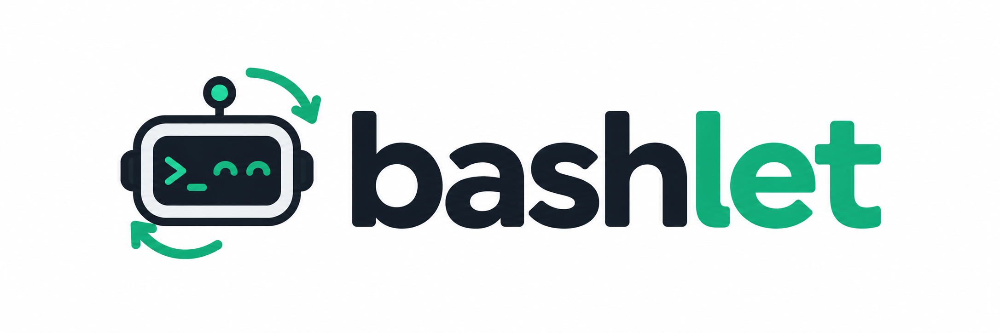

<h1 align="center">bashlet</h1>

<p align="center">
  
</p>

<p align="center">
  <strong>A Tiny Coding Agent with On-Policy Self-Distillation.</strong>
</p>

<p align="center">
  <a href="pyproject.toml"></a>
  <a href="configs/defaults.yaml"></a>
  <a href="#training"></a>
  <a href="configs/local-vllm/"></a>
</p>

<p align="center">
  <a href="#features">✨ 核心能力</a> ·
  <a href="#quickstart">🚀 快速开始</a> ·
  <a href="#models">🔌 接入真实模型</a> ·
  <a href="#training">🧬 训练与评测入口</a> ·
  <a href="#development">🛠️ 开发检查</a>
</p>

---

bashlet 是一个通过 bash 命令编写、运行和修复代码的极简编程智能体。项目为任务交互、后训练和评测提供共用的 Harness。

项目研究 On-Policy Self-Distillation（OPSD）：学生模型生成真实交互轨迹，同源的冻结教师利用训练任务的参考实现，为学生已采样的 token 提供概率监督。

<a id="features"></a>

## ✨ 核心能力

- 💻 **任务交互**：`agent` 接收自然语言指令和工作目录；`task` 运行带独立评分的编程任务。
- 🛡️ **隔离执行**：使用 Bubblewrap 沙箱，每步启动新 shell，工作区文件在步骤之间保留。
- 📝 **轨迹记录**：保存命令、真实观察、工作区变化，以及采样生成的原始 token 和 logprob。
- 🧠 **后训练与评测**：通过 PyTRIO 进行 OPSD；支持本地 vLLM 采样与评测。

<a id="quickstart"></a>

## 🚀 快速开始

### 🧰 环境要求

- **宿主环境**：Python 3.13+ 和 uv。
- **执行环境**：Linux，允许创建 user、mount、PID、network namespaces；提供 `/usr/bin/bwrap`、`/usr/bin/prlimit`、`/bin/bash`，以及 git、awk、sed、grep。
- **默认沙箱环境**：`/usr/bin/python3` 为 Python 3.10.12，独立虚拟环境使用锁定的 pytest 9.1.1。其他环境需调整[默认配置](configs/defaults.yaml)中的 `environment` 设置。

### 🧪 运行示例任务

在仓库根目录执行：

```bash
uv sync --locked
uv sync --project configs/sandbox-python --python /usr/bin/python3 --locked
uv run --locked bashlet task examples/sum.json
```

此示例使用 `ReplayModel` 的预写回复，在真实沙箱中运行代码、执行反馈测试并提交评分，无需 GPU 或 API Key。结束后会显示评分，产物保存在 `runs/<运行 ID>/`。

查看运行记录时，将 `runs/RUN_ID` 替换为 CLI 输出的运行目录：

```bash
uv run --locked bashlet show runs/RUN_ID
```

更多任务示例见 [examples/](examples/)。

### 🤖 直接运行 agent

对工作目录下达指令。以下示例仍使用预写回复：

```bash
mkdir -p runs/demo-input
uv run --locked bashlet agent "创建并运行 hello.py，然后提交" \
  --workdir runs/demo-input -c configs/replay-agent.yaml
```

`agent` 操作输入目录的副本，结果保存在本次运行的 `workspace/` 中。通过 `-c` 选择模型配置；多个配置按顺序覆盖，`--set key=value` 覆盖单项设置。

<a id="models"></a>

## 🔌 接入真实模型

将 `PYTRIO_API_KEY=你的密钥` 写入仓库根目录的 `.env`，使用 [PyTRIO 配置](configs/pytrio-smoke.yaml)运行云端 Qwen3.5-4B：

```bash
uv run --locked bashlet spend status
uv run --locked bashlet task examples/pytrio-smoke.json \
  -c configs/pytrio-smoke.yaml
```

远端采样与训练会产生 API 费用，统一使用 `runs/spend.sqlite3` 账本。预算设置见 [configs/spend.yaml](configs/spend.yaml)。

本地 vLLM 的环境见 [configs/local-vllm/](configs/local-vllm/)，运行配置见 [configs/local-base.yaml](configs/local-base.yaml)。使用前需准备模型权重，并调整服务地址、权重和快照清单路径。

<a id="training"></a>

## 🧬 训练与评测入口

OPSD 从原始指令模型开始，学生更新，特权教师冻结。训练使用 PyTRIO，评测使用本地 vLLM。

每个实验使用一个 YAML 入口。[configs/opsd.yaml](configs/opsd.yaml) 引用共用条件和预检配置；配置中的路径相对声明它的 YAML 文件解析。本地 tokenizer 路径使用 `./` 或 `../` 前缀，Hub 模型名保持原样。先准备数据、模型权重与服务环境，再按实际资源调整该配置。

```bash
uv run --locked bashlet train-opsd configs/opsd.yaml
uv run --locked bashlet train-opsd configs/opsd.yaml --resume
uv run --locked bashlet evaluate-checkpoint configs/opsd.yaml --phase final
uv run --locked bashlet watch-opsd --config configs/opsd.yaml
```

`train-opsd` 会先执行配置中的预检，再运行正式训练。每轮评测共享训练的 Harness、预算和采样条件，模型权重由保存的 checkpoint 确定。更改新实验的轮数、种子或预算只需改配置；同一运行恢复时必须保持其冻结条件。`--phase test` 仅允许在完整训练结束后访问最终测试集。

| 用途 | CLI 命令 | 配置或说明 |
| --- | --- | --- |
| 准备 MBPP 任务 | `prepare-mbpp` | [数据源](configs/mbpp-sanitized-v1.json) |
| 导入公开任务 | `import-public-tasks` | [公开来源](configs/opsd-public-import-v5.json)、[P3](configs/opsd-p3-import-v1.json) |
| 验证和冻结混合任务集 | `prepare-harness` | [当前数据计划](configs/opsd-expanded-plan-v1.json)、[准备说明](configs/opsd-expanded-data-v8.md) |
| 导出保存的权重 | `export-snapshot` | 使用 OPSD 运行中的 `training/` 目录 |
| 准备本地模型 | `prepare-local-snapshot` | 基模与导出的 adapter |
| 独立任务评测 | `evaluate` | 固定任务清单与已验证的本地模型 |

通过 `uv run --locked bashlet --help` 查看入口。历史 SFT 和旧协议实验使用对应 Git 版本；整理前的完整源码保存在标签 `opsd-536-before-refactor-20261016`。复现还需要相应数据、权重和锁定依赖。

<a id="development"></a>

## 🛠️ 开发检查

```bash
uv run --locked mypy
uv run --locked ruff check .
uv run --locked ruff format --check .
uv run --locked pytest
```

测试需要可用的 Bubblewrap namespaces，以及测试所用的 Qwen tokenizer 本地缓存。

---

项目术语见 [CONTEXT.md](CONTEXT.md)，架构决策见 [docs/adr/](docs/adr/)。
